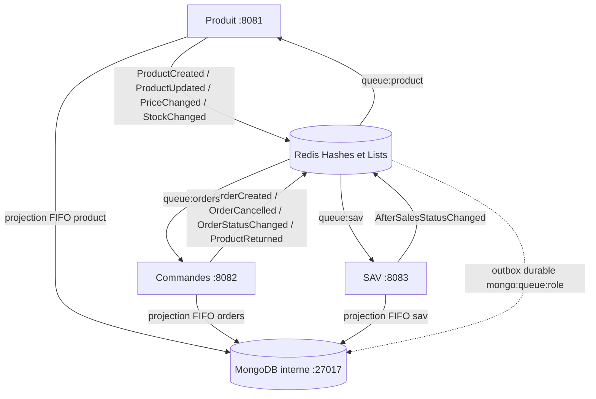

# Architecture réelle et cohérence des données

Java 21 / Spring Boot 3.5.7 ; un artefact Maven, trois conteneurs avec
`SERVICE_ROLE=product`, `orders`, `sav`. Sans frontend ni dépendance cloud.

La flèche pointillée représente les messages lus par les projecteurs Java : Redis
ne se connecte pas directement à MongoDB. Les événements passent exclusivement
par Redis ; chaque rôle écrit ensuite ses propres projections MongoDB.

| Propriétaire | Agrégat Redis | Collection MongoDB | Réplique locale |
|---|---|---|---|
| Produit | `product:{id}` | `products` | Aucune |
| Commandes | `order:{id}` | `orders` | `replica:product:{id}` / `product_replicas` |
| SAV | `sav:{id}` | `sav_tickets` | `replica:order:{id}` / `order_replicas` |

Toutes les clés Redis sont préfixées `protecphone:demo:` dans Compose.
Le registre `product:allocation:{commandeId}` est projeté dans `stock_allocations` ;
le statut SAV reçu par Commandes dans `sav_status_replicas`.
Collections dans la base MongoDB `protecphone`. Les services partagent un serveur
de chaque technologie pour la démonstration, avec une propriété logique des données.
Il n'y a pas d'isolation de sécurité par utilisateur de base dans cette configuration locale.

## Structures

Les fichiers `Aggregat-*.json` et `Replica-*.json` restent les références métier.
Produit contient `produitId`, `nom`, `compatibilite[]`, `variantes[]` avec couleur,
prix et stock par variante. Commande contient le client imbriqué, les lignes
(produit, modèle, couleur, quantité et prix), le total, la date et l'adresse.
SAV contient ticket, commande liée, motif, statut et messages datés.
La copie Produit conserve le document complet ; la copie Commande exclut
`adresseLivraison` et conserve client, lignes, total, date et statut.

Redis stocke chaque attribut de premier niveau dans un champ du Hash. Objets et
tableaux sont sérialisés en JSON, sans aplatir le client ni les variantes.
MongoDB conserve les objets et tableaux imbriqués sous forme de documents BSON.
Deux métadonnées techniques sont ajoutées sans modifier les exemples métier :
`_id` = clé Redis complète, et `_namespace` = `protecphone:demo`.
L'index unique `_id` évite les doublons. Les montants passent en nombres BSON
double dans cette démonstration ; le calcul Java utilise BigDecimal. Une application
financière de production devrait utiliser Decimal128 ou des centimes entiers.
Les dates restent des chaînes ISO-8601 conformes au modèle fourni.

## Rôle des bases et stratégie de synchronisation

Redis est le point de validation opérationnel : les règles métier lisent les Hashes.
Un commit Lua regroupe Hashes, publication des événements, identifiant traité,
acquittement et ajout d'un lot de documents à `mongo:queue:{role}`.
MongoDB est le stockage documentaire persistant et interrogeable des agrégats
et copies locales ; `GET /documents/{collection}/{id}` le consulte réellement.
Les routes GET historiques consultent Redis pour préserver la démonstration existante.

Chaque projecteur Java déplace le lot le plus ancien avec LMOVE vers
`mongo:processing:{role}`, puis remplace chaque document avec `replaceOne`,
filtre sur `_id`, `upsert=true`, écritures acquittées et journalisées.
Il retire le lot de processing uniquement après toutes les écritures MongoDB.
En cas d'échec, le lot reste en tête et est retenté. Après redémarrage, processing
est prioritaire sur queue. Un rejeu réécrit le même état au même `_id` ; aucun
incrément de stock n'est exécuté dans MongoDB. L'ordre FIFO empêche qu'une ancienne
écriture en reprise dépasse une projection récente du même rôle.

Il ne s'agit pas d'une transaction distribuée : HTTP 201 valide Redis et l'outbox,
pas la visibilité immédiate dans MongoDB. Un lot de plusieurs documents peut être
partiellement visible avant sa reprise. Après vidage des files, les documents
convergent ; la démonstration attend ce point et compare les deux bases.
Un MongoDB indisponible fait croître l'outbox, tout en autorisant les commandes Redis.
La santé agrégée devient DOWN tant qu'une base est indisponible.

## Événements et idempotence

| Type | Émetteur → destinataires | Effet |
|---|---|---|
| ProductCreated, ProductUpdated | Produit → Commandes | Remplacement de la copie Produit |
| PriceChanged, StockChanged | Produit → Commandes | Copie du Produit et de ses variantes actualisées |
| OrderCreated | Commandes → Produit, SAV | Réservation stock ; création copie Commande |
| OrderStatusChanged | Commandes → SAV | Statut de la copie |
| OrderCancelled | Commandes → Produit, SAV | Restitution stock et copie annulée |
| ProductReturned | Commandes → Produit | Restitution après retour |
| AfterSalesStatusChanged | SAV → Commandes | Copie du statut du ticket |

Enveloppe : `eventId`, `type`, `source`, `occurredAt`, `data`.
`events` conserve l'historique ; `queue:{role}` attend le traitement ;
`processing:{role}` permet la reprise ; `processed:{role}` déduplique ;
`metrics:{role}` compte les traitements ; `dead:{role}` conserve les rejets.
Les mutations de répliques et leur outbox sont produites par `Business.receive`,
jamais par un import de JSON statiques dans MongoDB.

Les doublons avec le même eventId sont acquittés sans effets supplémentaires.
Le registre d'allocation empêche une double réservation ou restitution même avec
un nouvel eventId. Les répliques n'ont pas de version métier pour filtrer un ancien
snapshot artificiellement renvoyé avec un nouvel eventId : ne pas faire ce rejeu.

## Limites et exploitation

Une instance par rôle, Redis non cluster et MongoDB autonome : pas de haute
disponibilité, pas de transaction MongoDB multi-document ni de garantie de stock
synchrone entre services. Un dépassement concurrent est conservé dans dead côté
Produit ; aucune compensation automatique de commande n'est annoncée.
Redis AOF `appendfsync always` et les deux volumes protègent les redémarrages testés,
pas la destruction des volumes, une perte disque ou une modification manuelle.
Les scripts Lua supposent des clés réservées du bon type ; Redis ne fournit pas
de rollback après une erreur d'exécution Lua (ex. clé corrompue / manque de mémoire).
Pas d'expiration/rotation automatique du journal ou de l'outbox : surveiller leur taille.
Un lot de projection invalide bloque volontairement sa file ; consulter les logs et
corriger la cause sans acquitter un document non écrit.

En cas de panne : `docker compose logs --tail 80 product orders sav`, inspecter
`processing`, `dead`, `mongo:processing`, puis redémarrer le composant concerné.
Ne pas vider les files pour masquer une panne. Pour ce jeu de démonstration réservé,
`python scripts/run.py demo --no-build` recharge proprement les deux bases.
Pour des données Redis antérieures à l'ajout MongoDB, ce rechargement est nécessaire
dans l'espace de démonstration ; aucune migration générale des données tierces n'est faite.

Références techniques : [LMOVE](https://redis.io/docs/latest/commands/lmove/),
[persistance Redis](https://redis.io/docs/latest/operate/oss_and_stack/management/persistence/),
[replaceOne et upsert](https://www.mongodb.com/docs/manual/reference/method/db.collection.replaceone/).
